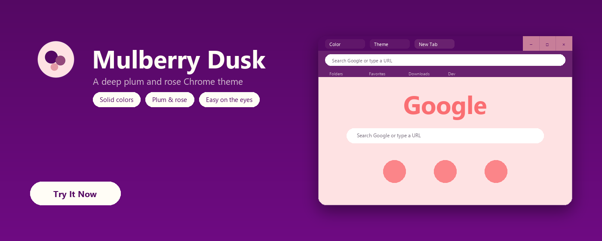
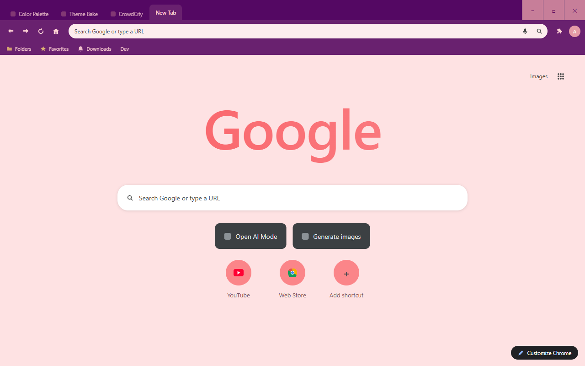
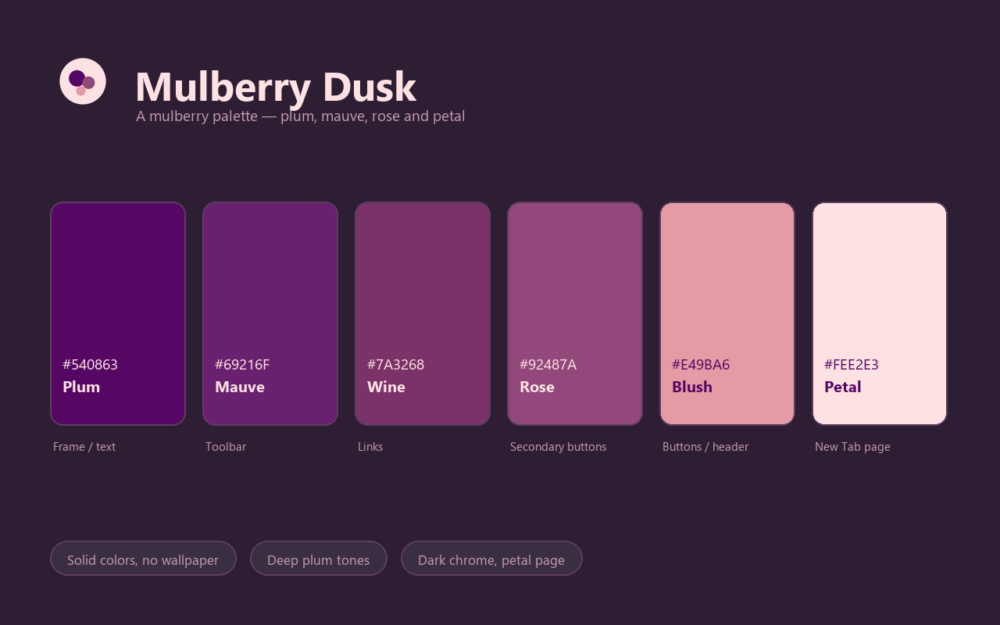

<p align="center">
  
</p>

<h1 align="center">Mulberry Dusk Theme</h1>

<p align="center">
  A deep plum Chrome theme with mauve, rose and a petal-pink New Tab Page.
</p>

<p align="center">
  
  
  
  
</p>

<p align="center">
  
</p>

## Overview

Mulberry Dusk is the last light on a berry hedge: a deep plum strip, a lighter mauve toolbar, and a petal-pink New Tab Page where Chrome paints its mark in a rose-coral gradient. Pale pink ink keeps every tab, bookmark and toolbar icon readable on the dark chrome, and rose and mauve carry the buttons.

## Design Concept

One plum→pink ramp, four depths, plus a pale page:

1. **Three separated surfaces** — plum frame `#540863`, lighter mauve toolbar `#69216F`, petal page `#FEE2E3`.
2. **One ink colour per surface** — pale pink `#FEE2E3` on the chrome, plum on the page (both ≈10:1 or better).
3. **The accent ramp stays inside the family** — rose `#E49BA6` for buttons, wine `#7A3268` for links (≈6:1, since `#92487A` only reaches 4.5:1).

| Color | Hex | RGB | Role |
|---|---|---|---|
| Plum | `#540863` | 84, 8, 99 | Frame / page text |
| Mauve | `#69216F` | 105, 33, 111 | Toolbar |
| Wine | `#7A3268` | 122, 50, 104 | New Tab links |
| Rose | `#92487A` | 146, 72, 122 | Secondary buttons |
| Blush | `#E49BA6` | 228, 155, 166 | Buttons / New Tab header |
| Petal | `#FEE2E3` | 254, 226, 227 | New Tab background / chrome ink |

## Features

- Pure color, no wallpaper — fast and distraction-free
- Deep plum chrome with pale pink ink — ≈10:1 contrast
- Petal-pink page that keeps Chrome's own Google mark on the warm side
- Tab text, bookmark text and toolbar icons all share the same pale ink
- Single-row shortcut row and a colour-matched mark for a clean New Tab Page
- No configuration needed — install and enjoy

## Screenshots

| Browser | Palette |
|:-:|:-:|
|  |  |

## Installation

### Load unpacked (development)

1. Download or clone this repository.
2. Open `chrome://extensions` in Chrome.
3. Enable **Developer mode** in the top right.
4. Click **Load unpacked** and select this folder (`mulberry-dusk-theme`).
5. The theme is active immediately.

### Package for the Chrome Web Store

```
chrome://extensions → Pack extension → select this folder → mulberry-dusk-theme.zip
```

Upload the resulting `.zip` to the [Chrome Web Store developer dashboard](https://chrome.google.com/webstore/devconsole).

## Store listing copy

Ready to paste into the store listing (also kept in `store-assets/store-description.txt`):

> Mulberry Dusk is a deep plum Chrome theme: a plum frame, a lighter mauve toolbar, and a petal-pink New Tab Page with a rose-coral Google mark. Pale pink ink keeps every tab, bookmark and toolbar icon readable on the dark chrome, with rose and mauve accents. Solid colors only, no wallpaper.

## Project structure

| File | Purpose |
|---|---|
| `manifest.json` | Theme definition (single-file, inlined `theme` field) |
| `logo/logo.png` | 128×128 store icon (transparent background) |
| `store-assets/promo/440x280.png` | Small promo tile |
| `store-assets/promo/1400x560.png` | Marquee promo tile |
| `store-assets/screenshots/en/screenshot-1-browser.png` | Browser mockup screenshot (1280×800) |
| `store-assets/screenshots/en/screenshot-2-palette.png` | Palette introduction screenshot (1280×800) |
| `store-assets/store-description.txt` | Store listing description |
| `scripts/generate-logo-vector.py` | Render all SVG logo candidates with headless Chromium, export `logo/logo.png` from `SELECTED` |
| `scripts/generate-screenshot-headless.py` | Regenerate the browser mockup via Playwright |
| `scripts/generate-screenshot-2-palette.py` | Regenerate the palette screenshot |
| `scripts/generate-promo.py` | Regenerate both promo tiles (1400×560 window hero, 440×280 dot palette) |
| `LICENSE` | Non-Commercial License (English / 中文) |

## Regenerating assets

Every asset is code-generated, so nothing here is hand-drawn or hand-copied:

```bash
py -3 scripts/generate-logo-vector.py         # candidates + logo/logo.png
py -3 scripts/generate-screenshot-headless.py # store screenshot 1 (browser mockup)
py -3 scripts/generate-screenshot-2-palette.py # store screenshot 2 (palette)
py -3 scripts/generate-promo.py               # promo 440x280 + 1400x560
```

To ship a different icon candidate, change `SELECTED` at the top of `generate-logo-vector.py` and re-run, then re-run the three asset scripts so the promo and screenshots pick up the new logo.

## License

Mulberry Dusk Theme is released under the Non-Commercial License. See `LICENSE` for full text (English / 中文).
